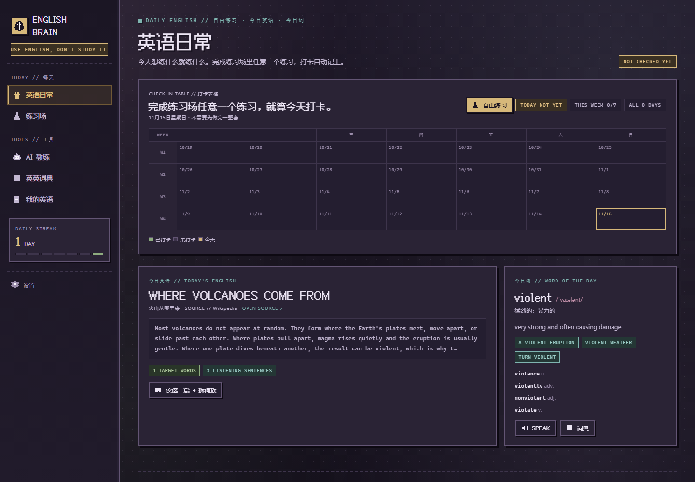
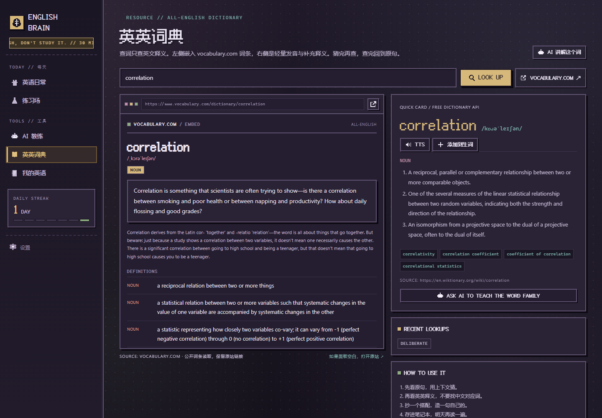

# ENGLISH BRAIN // 英语训练场

一个**练习优先**的本地英语学习站：不是把课程放到网页里讲一遍，而是每天用一套方法真正读、猜、造句、听写。




## 它是什么

- **英语日常**：打卡表格、今日英语（AI 材料）、今日词；打卡表上有自由练习入口。完成任意一个模块的今日全部内容才打卡
- **练习场**：语境猜词、习语库、四词、句式变化、段落变化、听写、描述、写作（8 个）
- **习语库**：保留所有历史习语；每天从没标熟识的习语里随机展示 4 个，也可以从习语库自由选择；点「熟识」后不再进入随机池
- **句式变化**：写完变体后点 AI CHECK，AI 反馈成功后才展示参考变体例句
- **段落变化**：中文翻译在提交 AI CHECK 后才显示；AI 反馈取代本地检查
- **描述练习**：无倒计时；只保留生活化场景、三层描述提示和输入框；底部 TIPS 已移除
- **写作训练**：无倒计时；提示默认隐藏、点击展开；修订清单只作为 AI CHECK 内部规则，不展示
- **自动保存草稿**：写作、描述、段落变化的输入框自动保存到 SQLite，不再需要 SAVE；Ctrl+Z 仍可回退输入
- **猜词判定**：输入猜测后 REVEAL，正确/错误有独立反馈；猜错自动进「生词」，猜对可点「标熟」进入「熟词」，熟词可取消
- **四词只用熟词**：四词练习从「我的英语 · 熟词」随机取 4 个词；不足 4 个时显示收词入口
- **单词分类**：我的英语支持全部 / 生词 / 熟词筛选，单词卡可跳英英词典，右下角可展开词族
- **词典手动添加**：查词不再自动写进我的英语，点「添加到生词」才保存
- **每日材料历史**：每个练习每天生成一份新材料并进入下拉框；旧材料做完后默认展示新材料，没做完继续展示旧材料，下拉框中用 ✓ 标记练过的日期
- **AI 材料**：每日阅读、词汇、听写、描述、写作、习语、变体由 DeepSeek 生成；内容偏城市日常生活（通勤、咖啡、便利店、邻居、公寓、小计划等），阅读以 Wikipedia 真实条目为种子
- **全局 AI BOT**：固定在右下角，根据当前模块加载上下文、预设问题和聊天；模块内不再显示 AI MATERIAL / AI FEEDBACK
- **工具**：vocabulary.com 英英词条、Free Dictionary、Datamuse、全局 AI BOT
- **SQLite 自动存储**：进度、生词/熟词、句子、草稿、AI 反馈、打卡和生成材料写入本地数据库

## 本地运行

要求 Node.js 22+（内置 `node:sqlite`）。

```bash
cd brain-web
npm install
cp .dev.vars.example .dev.vars
# 填入 DEEPSEEK_API_KEY；不填也能打开，AI/生成材料会进入本地示例模式
npm run dev
```

打开 <http://127.0.0.1:8788>。

`npm run dev` 启动 `scripts/local-server.mjs`，同时提供：

- 静态页面
- `/api/state` — SQLite 进度读写
- `/api/materials` — AI 生成 / 读取当天材料 / 历史材料
- `/api/vocab` — vocabulary.com 公开词条
- `/api/words` — Datamuse 同义词
- `/api/ai` — DeepSeek 流式代理
- `/api/status` — 是否配置了 key

不需要 Cloudflare、Wrangler 或任何云服务。

## 数据

- 数据库：`data/english-brain.db`
- 表：profile、active_days、session_blocks、visited_labs、lab_stats、notebook_words、phrases、drafts、reports、dict_history、coach_messages、settings、materials、checkins、material_done、idioms
- 浏览器不再使用 localStorage 或 JSON 文件保存进度。
- 删除数据库即可重置全部数据；设置里的 RESET 会清空进度、草稿和生成材料。

## AI / 材料

- `.dev.vars` 中配置 `DEEPSEEK_API_KEY`
- 每天第一次打开时生成一份“每日材料包”，写入 SQLite；当天后续读取缓存
- 阅读种子来自 Wikipedia API（站点资源链接之一），AI 再改写成 80–120 词练习短文
- 没有 key 时，站点使用内置示例材料并在界面标记 `LOCAL MODE`；配置 key 后自动替换

## 主题配色

- 默认中灰紫纸面 `#564C63`，次层 `#605670`，卡片 `#6E637C` / `#675C75` / `#796D87`
- 设置中可切换 **灰紫 / 冷雾蓝 / 松林绿 / 灰玫瑰**，也可以用系统取色器自定义任意颜色；选择后立即应用并自动保存
- 文字 `#EDE6F5` / `#C2B7D1` / `#9A8CAA`
- 2px 边框 `#635574`，硬投影 `#0D0912`
- 七组强调色：珊瑚、琥珀、橄榄、青绿、雾蓝、薰衣草、玫瑰；砖红补充
- Fusion Pixel 做界面与标题，系统无衬线做正文，等宽做代码
- 正文 14.5px / 1.8，零圆角，零毛玻璃，零模糊

## 目录

```text
brain-web/
├─ public/
│  ├─ index.html
│  ├─ css/app.css
│  ├─ js/
│  │  ├─ app.js          # 路由、侧栏、设置
│  │  ├─ views.js        # 英语日常、练习场
│  │  ├─ labs.js         # 8 个练习界面
│  │  ├─ tools.js        # 词典、我的英语
│  │  ├─ data.js         # 方法、题库、场景、资源
│  │  ├─ materials.js    # AI 材料包注入 / 每日历史与选择
│  │  ├─ services.js     # DeepSeek / 词典 / TTS / 本地反馈
│  │  ├─ store.js        # SQLite 客户端
│  │  ├─ ui.js           # DOM / 计时器 / diff
│  │  └─ icons.js        # 像素图标与插画
│  └─ assets/            # 字体与预览图
├─ functions/api/        # 本地 API 实现
├─ scripts/
│  ├─ local-server.mjs   # 本地静态 + API 服务
│  ├─ db.mjs             # SQLite 表与读写
│  ├─ generator.mjs      # AI 每日材料生成
│  └─ test-ui.mjs        # Playwright 冒烟测试（可选）
├─ data/                 # SQLite 数据库（自动创建，不提交）
├─ .dev.vars.example
├─ package.json
└─ README.md
```

## 快捷键

| 键 | 动作 |
|---|---|
| `G` `H` | 英语日常 |
| `G` `L` | 练习场 |
| `G` `D` | 英英词典 |
| `G` `N` | 我的英语 |
| `/` | 打开词典 |
| `Esc` | 关闭手机侧栏 |
| `Space` | 听写页播放 / 停止 |

## 隐私

- 没有账号、数据库服务、统计脚本、追踪 cookie。
- 所有学习数据只写在本地 `data/english-brain.db`。
- 只有 AI 发送或生成材料时，文本才会经过本地代理发往 DeepSeek。
- 阅读种子来自 Wikipedia 公开 API，并在练习中标出来源链接。

## Credits

- 方法来源：*Building Your English Brain* — Luke Priddy / Cloud English
- 字体：[Fusion Pixel Font](https://github.com/TakWolf/fusion-pixel-font)，SIL Open Font License
- 英英词条：[vocabulary.com](https://www.vocabulary.com/)
- 释义 / 发音：[Free Dictionary API](https://dictionaryapi.dev/)
- 同义词：[Datamuse](https://www.datamuse.com/api/)
- AI：[DeepSeek](https://api-docs.deepseek.com/)
